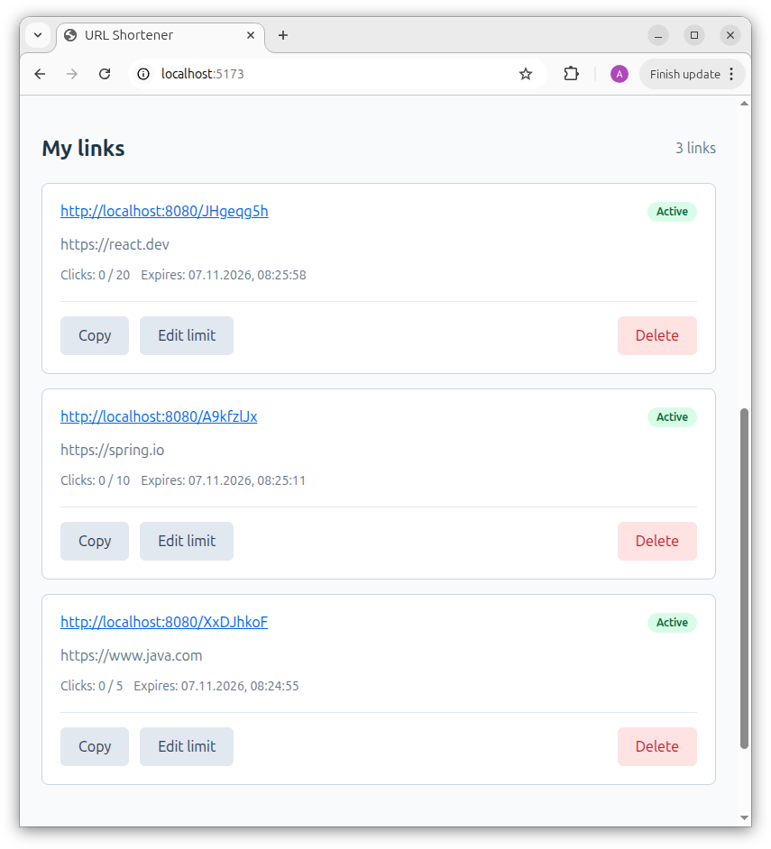
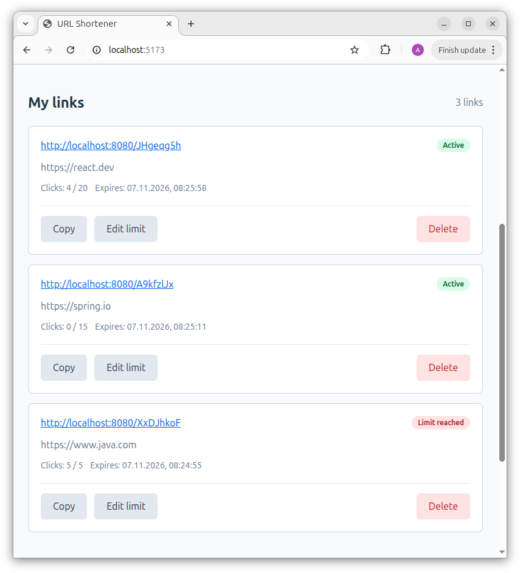
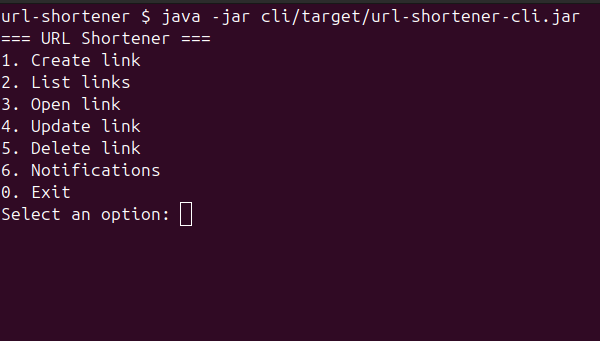

[](https://github.com/ab-sandbox/mephi-java-url-shortener/actions/workflows/ci.yml)
[](https://github.com/ab-sandbox/mephi-java-url-shortener/releases/latest)

## URL Shortener

Сервис сокращения URL с ограничением количества переходов, временем жизни ссылок и системой уведомлений.

Проект разработан по практическому кейсу компании **PROMO IT**
в рамках образовательной программы **НИЯУ МИФИ**.
Реализован как клиент-серверное приложение на Java 21 с REST API, базой данных PostgreSQL и двумя независимыми
клиентами — веб-интерфейсом на React и консольным приложением.

### Возможности

- Создание коротких ссылок с уникальными кодами.
- Ограничение количества переходов по ссылке.
- Автоматическое истечение срока действия ссылок.
- Учет переходов с защитой от превышения лимита при конкурентных запросах.
- Идентификация пользователей по UUID.
- Просмотр, изменение и удаление собственных ссылок.
- Уведомления об истечении срока действия и достижении лимита переходов.
- Автоматическая очистка просроченных ссылок.
- Веб-интерфейс для управления ссылками и уведомлениями.
- Консольный клиент с командным и интерактивным режимами.

### Релиз и документация

Текущая стабильная версия — **[v1.0.0](https://github.com/ab-sandbox/mephi-java-url-shortener/releases/tag/v1.0.0)**.

- [GitHub Releases](https://github.com/ab-sandbox/mephi-java-url-shortener/releases) — опубликованные версии и история
  релизов.
- [Frontend](frontend/README.md) — веб-интерфейс на React и TypeScript.
- [CLI](cli/README.md) — консольный клиент на Java 21.
- [GitHub Actions](https://github.com/ab-sandbox/mephi-java-url-shortener/actions/workflows/ci.yml) — результаты
  автоматических проверок.

### Архитектура

Приложение состоит из трех основных компонентов:

| Компонент | Назначение                                             | Документация                             |
|-----------|--------------------------------------------------------|------------------------------------------|
| Backend   | REST API, бизнес-логика, хранение ссылок и уведомлений | [backend/](backend/)                     |
| Frontend  | Веб-интерфейс на React и TypeScript                    | [frontend/README.md](frontend/README.md) |
| CLI       | Консольный клиент на Java 21                           | [cli/README.md](cli/README.md)           |

Оба клиента взаимодействуют с одним REST API и используют общий механизм идентификации пользователей по UUID.

```text
          React + TypeScript        Java CLI
                 |                     |
                 +----------+----------+
                            |
                      REST API
                            |
                     Spring Boot
                            |
                 Spring Data JPA
                            |
                       PostgreSQL
```

### Технологии

| Компонент      | Технологии                                       |
|----------------|--------------------------------------------------|
| Backend        | Java 21, Spring Boot, Spring Data JPA, Hibernate |
| Frontend       | React, TypeScript, Vite                          |
| CLI            | Java 21, picocli, Java HttpClient, Jackson       |
| База данных    | PostgreSQL 16, Flyway                            |
| Инфраструктура | Docker Compose, Maven, npm                       |
| Тестирование   | JUnit 5, Spring Boot Test, Testcontainers        |

### Демонстрация

#### Веб-интерфейс

Создание коротких ссылок, просмотр статистики переходов и управление ограничениями.



После достижения лимита переходов ссылка становится недоступной.



Подробное описание возможностей и дополнительные скриншоты — в [документации frontend](frontend/README.md).

#### Консольный клиент

CLI поддерживает интерактивное меню и выполнение отдельных команд из терминала.



Подробное описание команд и дополнительные скриншоты — в [документации CLI](cli/README.md).

### Структура проекта

```text
mephi-java-url-shortener/
├── backend/          # Spring Boot REST API
├── frontend/         # React + TypeScript
├── cli/              # Консольный клиент Java
├── docs/
│   └── screenshots/  # Скриншоты приложения
├── pom.xml           # Корневой Maven-проект
└── README.md
```

Backend и CLI реализованы как отдельные Maven-модули. Frontend представляет собой самостоятельное приложение на React с
использованием Vite.

### Запуск

#### Требования

- JDK 21
- Docker и Docker Compose
- Node.js и npm
- Maven Wrapper (включен в проект)

#### 1. PostgreSQL

Из корневой директории проекта:

```bash
docker compose up -d
```

#### 2. Backend

Сборка и тестирование Java-модулей:

```bash
./mvnw clean verify
```

REST API:

```bash
./mvnw -pl backend spring-boot:run
```

Backend по умолчанию доступен по адресу `http://localhost:8080`.

#### 3. Frontend

В отдельном терминале:

```bash
cd frontend
npm install
npm run dev
```

Веб-интерфейс доступен по адресу `http://localhost:5173`.

В режиме разработки Vite перенаправляет запросы `/api/*` на backend по адресу `http://localhost:8080`.

Подробнее — [возможности frontend](frontend/README.md).

#### 4. CLI

Из корневой директории проекта:

```bash
./mvnw -pl cli -am package
java -jar cli/target/url-shortener-cli.jar
```

Для просмотра доступных команд:

```bash
java -jar cli/target/url-shortener-cli.jar --help
```

По умолчанию CLI подключается к `http://localhost:8080`. Адрес можно изменить через переменную окружения
`URL_SHORTENER_API_URL`.

Подробнее — [команды CLI](cli/README.md).

### REST API

| Метод  | Endpoint                       | Описание                             |
|--------|--------------------------------|--------------------------------------|
| POST   | `/api/links`                   | Создание ссылки                      |
| GET    | `/api/links`                   | Список ссылок пользователя           |
| PATCH  | `/api/links/{code}`            | Изменение лимита переходов           |
| DELETE | `/api/links/{code}`            | Удаление ссылки                      |
| GET    | `/{code}`                      | Переход по короткой ссылке           |
| GET    | `/api/notifications`           | Список уведомлений                   |
| GET    | `/api/notifications/unread`    | Непрочитанные уведомления            |
| PATCH  | `/api/notifications/{id}/read` | Отметка уведомления как прочитанного |

Для пользовательских операций используется заголовок `X-User-Id`.

Идентификатор пользователя сохраняется клиентом между еками. Регистрация и полноценная аутентификация в текущей
реализации не предусмотрены.

### Тестирование

Проект включает модульные и интеграционные тесты, в том числе проверку конкурентных переходов по ссылке с ограниченным
количеством использований.

Запуск всех тестов:

```bash
./mvnw test
```

Проверка frontend:

```bash
cd frontend
npm run lint
npm run build
```

## Автоматизация

В проекте настроен CI на базе [GitHub Actions](.github/workflows/ci.yml).

Проверки автоматически запускаются при push в `main` и создании pull request:

- **Java:** сборка Maven, модульные и интеграционные тесты, включая Testcontainers.
- **Frontend:** установка зависимостей, проверка ESLint и production-сборка React-приложения.

Для согласованного форматирования исходного кода используется
[EditorConfig](.editorconfig). Настройки задают кодировку UTF-8,
окончания строк и правила отступов для Java, TypeScript, CSS и других файлов.

Успешное выполнение CI подтверждает прохождение настроенных автоматических проверок.

### О проекте

Проект основан на практическом кейсе компании **PROMO IT**, предложенном в рамках
образовательной программы **НИЯУ МИФИ**.
