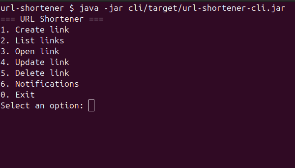
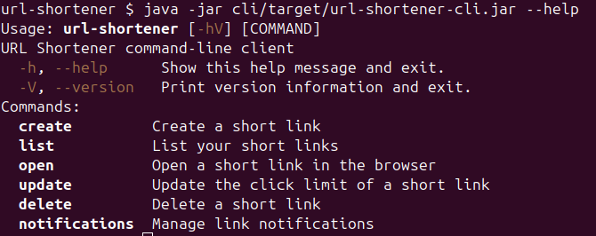
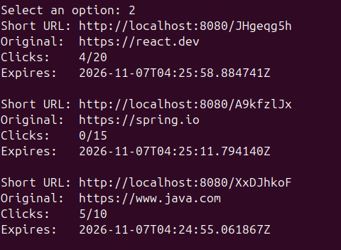
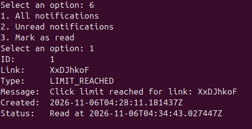

## URL Shortener CLI

Консольный клиент для управления короткими ссылками через REST API сервиса URL Shortener.

Реализован на Java 21 с использованием picocli и Java HttpClient. Поддерживает интерактивное меню и запуск отдельных
команд из терминала.

### Возможности

- Создание коротких ссылок с ограничением количества переходов.
- Просмотр списка созданных ссылок.
- Открытие ссылок в браузере.
- Изменение лимита переходов.
- Удаление ссылок.
- Просмотр уведомлений и отметка их как прочитанных.
- Сохранение идентификатора пользователя между запусками.

### Сборка

Из корневой директории проекта:

```bash
./mvnw -pl cli -am package
```

После сборки исполняемый JAR находится по пути:

```text
cli/target/url-shortener-cli.jar
```

### Запуск

Для работы клиента необходимо запустить [backend](../backend).

#### Интерактивный режим

```bash
java -jar cli/target/url-shortener-cli.jar
```

При запуске без аргументов открывается меню:



### Командный режим

CLI поддерживает выполнение отдельных команд без интерактивного меню.

Для просмотра доступных команд:

```bash
java -jar cli/target/url-shortener-cli.jar --help
```



Доступны команды `create`, `list`, `open`, `update`, `delete` и `notifications`.

Подробную справку по каждой команде можно получить через `--help`, например:

```bash
java -jar cli/target/url-shortener-cli.jar create --help
```

### Управление ссылками

Клиент позволяет создавать ссылки, просматривать их параметры и изменять ограничения на количество переходов.



Каждая ссылка содержит оригинальный URL, сокращенный адрес, счетчик переходов и время истечения срока действия.

### Уведомления

При достижении лимита переходов или наступлении других поддерживаемых событий backend создает уведомления.

CLI позволяет просматривать уведомления и отмечать их как прочитанные.



### Конфигурация

По умолчанию клиент обращается к API по адресу:

```text
http://localhost:8080
```

Для изменения адреса используется переменная окружения `URL_SHORTENER_API_URL`:

```bash
URL_SHORTENER_API_URL=http://localhost:8081 \
  java -jar cli/target/url-shortener-cli.jar
```

### Пользовательская сессия

При первом создании ссылки backend выдает UUID пользователя. CLI сохраняет его в локальном файле:

```text
~/.url-shortener/session.properties
```

При последующих запросах идентификатор передается в заголовке `X-User-Id`.

Регистрация и авторизация не требуются. UUID используется для идентификации владельца ссылок и уведомлений, но не
является механизмом безопасной аутентификации.

### Технологии

- Java 21
- picocli
- Java HttpClient
- Jackson
- Maven
- JUnit 5

---

[Вернуться к основному README](../README.md)
