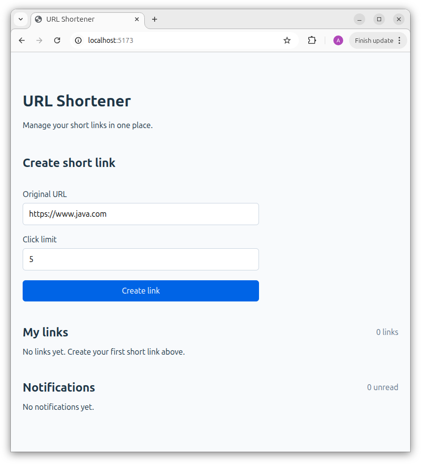
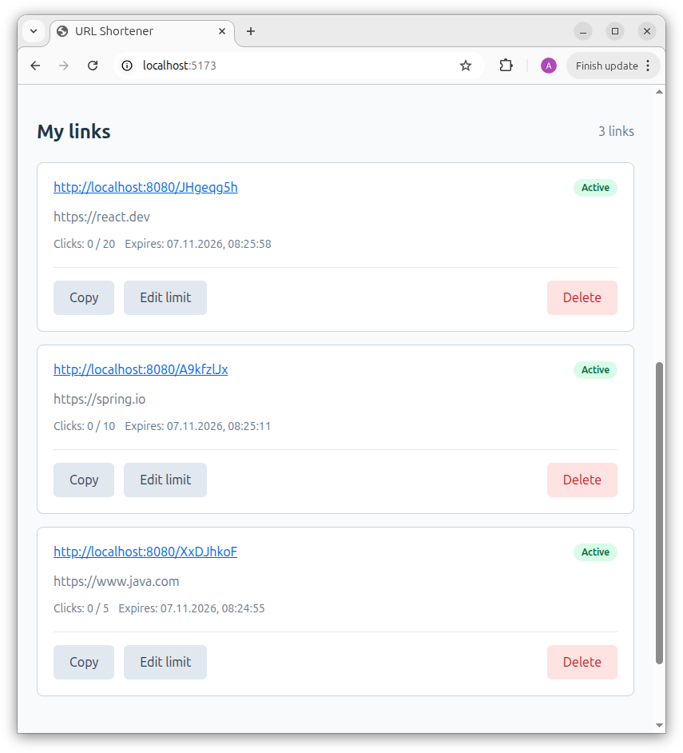
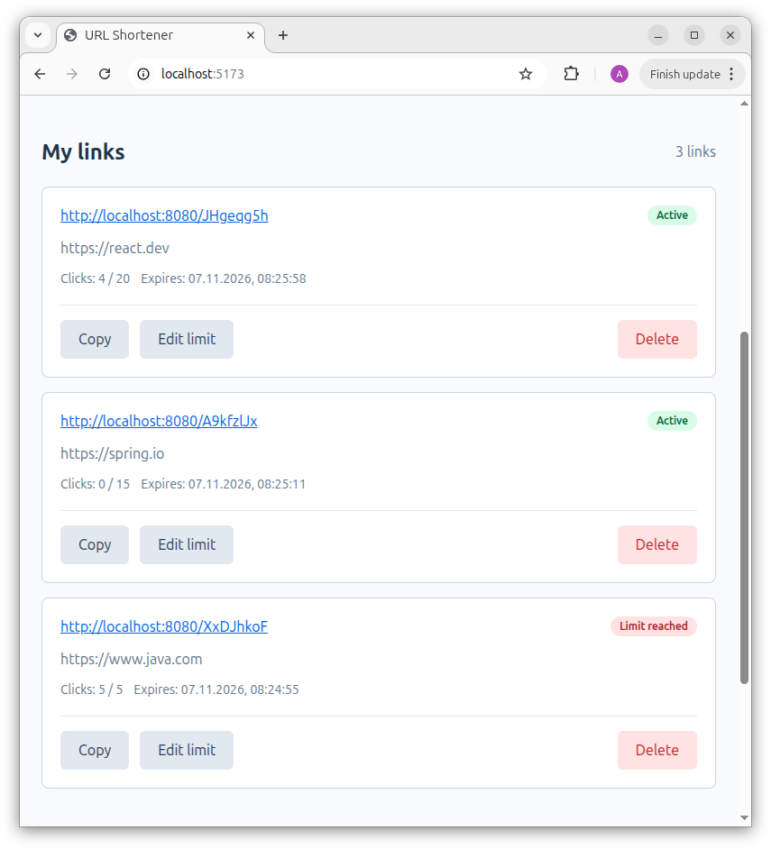
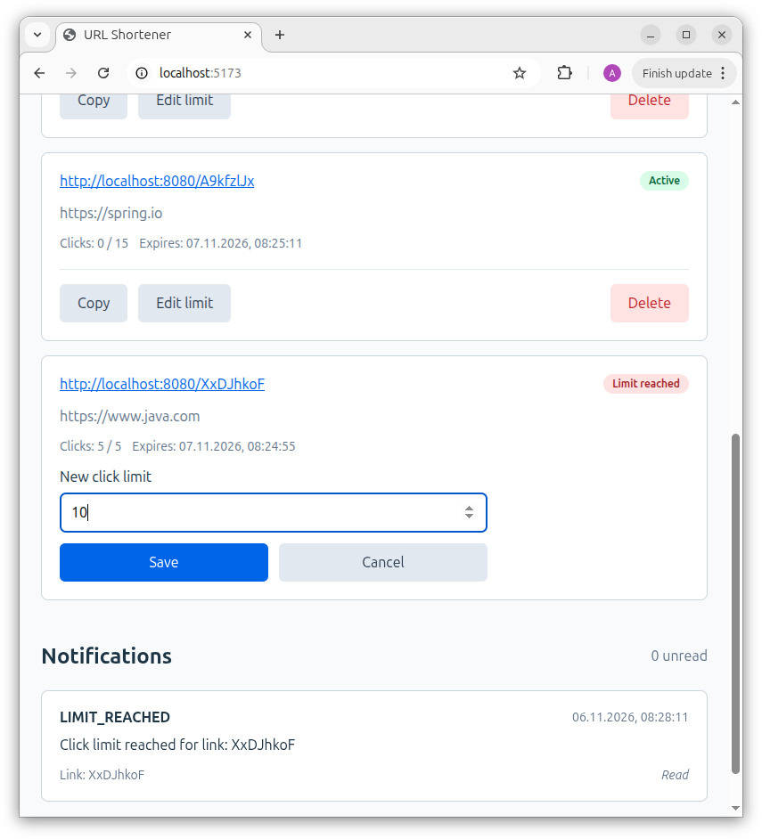
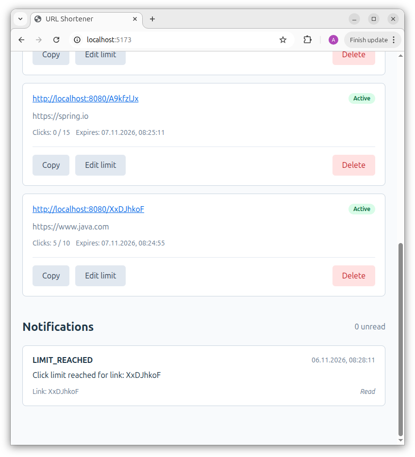
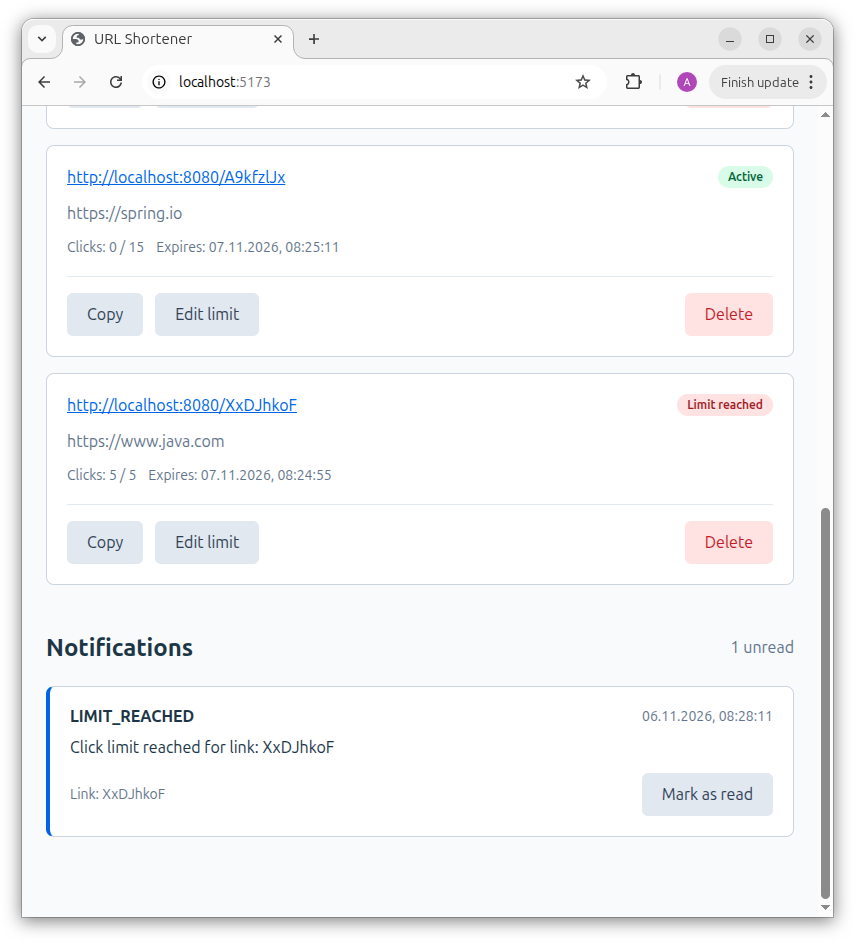
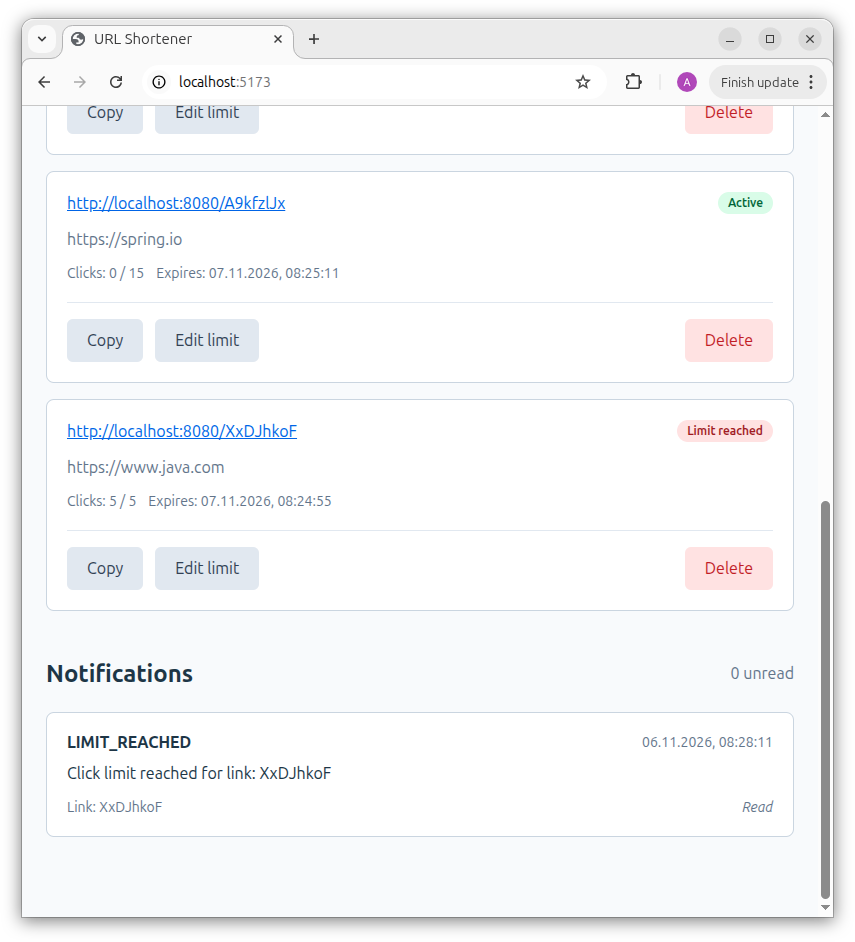

## URL Shortener — Frontend

Веб-клиент сервиса сокращения URL, разработанный на **React** и **TypeScript**.

Позволяет создавать короткие ссылки, управлять ограничениями переходов и просматривать уведомления через REST API
backend-приложения.

### Возможности

- Создание коротких ссылок с заданным лимитом переходов.
- Просмотр ссылок, счетчиков переходов и сроков действия.
- Отображение текущего состояния ссылки: `Active`, `Limit reached`, `Expired`.
- Изменение лимита переходов.
- Копирование коротких URL в буфер обмена.
- Удаление ссылок.
- Просмотр уведомлений и отметка их как прочитанных.
- Сохранение идентификатора пользователя между сеансами браузера.

### Технологии

- React
- TypeScript
- Vite
- Fetch API
- CSS

### Запуск

Для работы веб-клиента необходимо запустить backend сервиса URL Shortener.

Из директории `frontend` установить зависимости:

```bash
npm install
```

Запустить сервер разработки:

```bash
npm run dev
```

По умолчанию приложение доступно по адресу:

`http://localhost:5173`

### Подключение к backend

В режиме разработки Vite использует proxy для перенаправления запросов к Spring Boot REST API.

```typescript
server: {
  proxy: {
    "/api": {
      target: "http://localhost:8080",
      changeOrigin: true,
    },
  },
}
```

Таким образом, frontend работает на `http://localhost:5173`, а запросы к `/api/*` перенаправляются на backend по адресу
`http://localhost:8080`.

Настройка находится в файле `vite.config.ts` и применяется только при запуске сервера разработки. Для
production-развертывания необходимо отдельно настроить маршрутизацию API-запросов.

#### Проверка и сборка

Проверка кода:

```bash
npm run lint
```

Создание production-сборки:

```bash
npm run build
```

Результат сборки размещается в директории `dist/`.

### Демонстрация работы

#### 1. Создание короткой ссылки

Пользователь указывает оригинальный URL и максимальное количество переходов.



После создания ссылка появляется в списке пользователя.



#### 2. Ограничение количества переходов

Backend учитывает каждый успешный переход по короткой ссылке.

После достижения установленного лимита ссылка становится недоступной, а интерфейс отображает состояние `Limit reached`.



#### 3. Изменение лимита

Пользователь может изменить максимально допустимое количество переходов.



Если новый лимит превышает текущее количество переходов и срок действия ссылки не истек, она снова становится активной.



#### 4. Уведомления

При достижении лимита переходов backend создает уведомление.

Непрочитанные уведомления выделяются в интерфейсе.



После нажатия `Mark as read` уведомление остается в истории, но отображается как прочитанное.



Уведомления фиксируют произошедшие события и сохраняются после изменения лимита или удаления ссылки.

### Взаимодействие с backend

Frontend обращается к REST API Spring Boot приложения для управления ссылками и уведомлениями.

Для идентификации пользователя используется UUID, который сохраняется в `localStorage` под ключом:

```text
url-shortener-user-id
```

При последующих запросах UUID передается в заголовке `X-User-Id`.

Регистрация и авторизация в текущей реализации не предусмотрены. UUID используется для идентификации пользователя, но не
обеспечивает безопасную аутентификацию.

### Структура проекта

```text
frontend/
├── public/
├── src/
│   ├── api/          # Запросы к REST API
│   ├── components/   # React-компоненты
│   ├── types/        # TypeScript-типы
│   ├── utils/        # Пользовательская сессия
│   ├── App.tsx
│   └── main.tsx
├── package.json
└── vite.config.ts
```

---

[Вернуться к основному README](../README.md)
